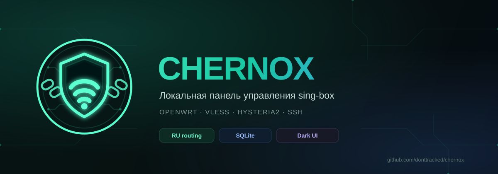

<div align="center">
  
</div>

<div align="center">

**Локальная веб-панель управления sing-box на OpenWrt**

[](https://www.python.org/)
[](https://openwrt.org/)
[](https://sing-box.sagernet.org/)
[](https://sqlite.org/)
[](https://t.me/project_chernox)
[](https://github.com/donttracked/chernox)

</div>

Chernox — лёгкая панель для OpenWrt: ключи хранятся в SQLite, VPN включается одной кнопкой, маршрутизация настраивается из интерфейса. Без внешнего сервера.

---

## ✨ Возможности

| | Возможность | Описание |
|:---:|:---|:---|
| 🛡️ | **Три протокола** | VLESS, Hysteria2 и SSH — ссылки и JSON-конфиги sing-box |
| 🔀 | **RU-маршрутизация** | Весь трафик через VPN, RU-сайты напрямую или только RU через VPN |
| 🗄️ | **SQLite-хранилище** | Ключи сохраняются в локальной базе |
| 🌙 | **Тёмный интерфейс** | Без тяжёлых анимаций, картинок и внешних шрифтов |
| 🔐 | **Защита входа** | Пароль, CSRF-токены и лимит попыток входа |
| ⚡ | **Лёгкий стек** | Python stdlib + SQLite, без Flask и Node.js |
| 🧪 | **Проверка конфига** | Перед применением выполняется `sing-box check` |
| 💾 | **Резервная копия** | Старый конфиг сохраняется в `config.json.bak` |

---

## 🧩 Протоколы

| Протокол | Формат | Поддержка |
|:---|:---|:---|
| **VLESS** | `vless://...` | TCP, WebSocket, gRPC, TLS, Reality |
| **Hysteria2** | `hysteria2://...` или `hy2://...` | Пароль, SNI, insecure, obfs, up/down, mport |
| **SSH** | `ssh://...` | Логин/пароль или приватный ключ |

Остальные протоколы отклоняются.

---

## 🔀 Маршрутизация

| Режим | Поведение |
|:---|:---|
| 🌐 **Весь трафик через VPN** | Все сайты идут через активный ключ |
| 🇷🇺 **RU-сайты напрямую** | Российские домены и IP — напрямую, остальное — через VPN |
| 🎯 **Только RU через VPN** | Российские сайты — через VPN, остальное — напрямую |

Для раздельных режимов нужен `sing-box` **1.8+**. Списки RU-сайтов скачиваются автоматически.

---

## 📦 Установка

Одна команда на роутере от root:

```sh
wget -qO /tmp/chernox.sh https://github.com/donttracked/chernox/raw/HEAD/install_panel.sh && sh /tmp/chernox.sh
```

Если нет `wget`:

```sh
curl -fsSL https://github.com/donttracked/chernox/raw/HEAD/install_panel.sh -o /tmp/chernox.sh && sh /tmp/chernox.sh
```

Скрипт сам скачает `panel.py`, поставит `sing-box`, tproxy, DNS, Python и SQLite, спросит порт и пароль, создаст службу и откроет порт только для LAN.

После установки:

```text
http://<IP-роутера>:8080
```

---

## 💚 Поддержать проект

**USDT TRC20**

```text
TEAv7pZVgA6TVH3APrxVi9HFMqg94dDaAM
```

[](https://t.me/project_chernox)
[](https://github.com/donttracked/chernox)

---

> [!WARNING]
> Не открывайте порт панели в интернет. Используйте только в локальной сети.

<div align="center">

**Chernox** · сделано для OpenWrt

</div>
